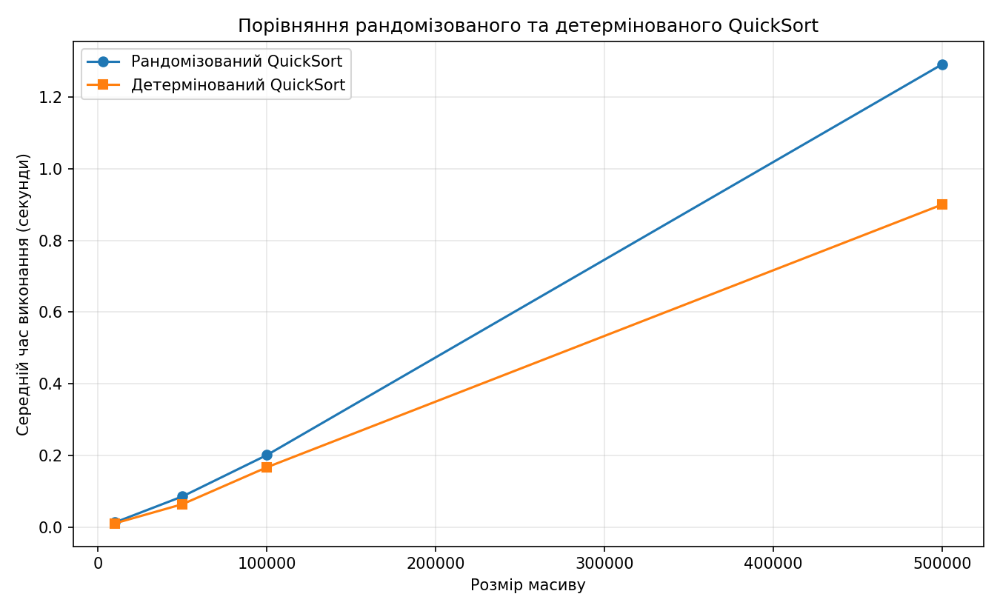

# Завдання 1. Рандомізований vs детермінований QuickSort

## Алгоритм
Обидві функції використовують спільну реалізацію QuickSort із триланковим розбиттям
на елементи `< pivot`, `== pivot`, `> pivot` (коректно обробляє дублікати).
Відрізняється лише вибір опорного елемента:

- `randomized_quick_sort(arr)` — pivot обирається випадково;
- `deterministic_quick_sort(arr)` — pivot — середній елемент (`arr[len(arr) // 2]`).

## Складність
| Випадок | Рандомізований | Детермінований |
|---|---|---|
| Середній | O(n log n) | O(n log n) |
| Найгірший | O(n²) (малоймовірний для будь-якого входу) | O(n²) (на спеціально підібраних входах) |
| Додаткова пам'ять | O(n) | O(n) |

Випадковий вибір pivot робить найгірший випадок неймовірним незалежно від вхідних даних,
тоді як фіксоване правило можна «зламати» спеціально підготовленим масивом.

## Методика
Масиви розмірів 10 000, 50 000, 100 000 та 500 000 заповнюються випадковими цілими числами
(`random.seed(42)`). Кожен алгоритм запускається 5 разів на копії масиву, береться середній час
(`time.perf_counter`). Коректність перевіряється порівнянням із `sorted`.

## Результати (запуск у середовищі розробки)
```
Розмір масиву: 10000
   Рандомізований QuickSort: 0.0134 секунд
   Детермінований QuickSort: 0.0109 секунд

Розмір масиву: 50000
   Рандомізований QuickSort: 0.0860 секунд
   Детермінований QuickSort: 0.0643 секунд

Розмір масиву: 100000
   Рандомізований QuickSort: 0.2013 секунд
   Детермінований QuickSort: 0.1672 секунд

Розмір масиву: 500000
   Рандомізований QuickSort: 1.2910 секунд
   Детермінований QuickSort: 0.8999 секунд
```

| Розмір | Рандомізований, с | Детермінований, с |
|---:|---:|---:|
| 10 000 | 0.0134 | 0.0109 |
| 50 000 | 0.0860 | 0.0643 |
| 100 000 | 0.2013 | 0.1672 |
| 500 000 | 1.2910 | 0.8999 |



> Абсолютні значення залежать від машини; на вашому комп'ютері числа будуть іншими.

## Висновки
1. Обидва алгоритми демонструють зростання часу, близьке до O(n log n): при збільшенні
   розміру масиву в 50 разів (10k → 500k) час зростає приблизно в 80–120 разів, що узгоджується з n log n.
2. На випадкових даних детермінований QuickSort (середній pivot) виявився швидшим за
   рандомізований приблизно на 15–30 %. Причина — накладні витрати на виклик генератора
   випадкових чисел на кожному рекурсивному виклику; кількість порівнянь у середньому однакова.
3. Перевага рандомізації — не в швидкості на випадкових даних, а в надійності: вона захищає від
   вироджених вхідних даних і навмисно побудованих «поганих» масивів, на яких
   детермінований вибір pivot дає O(n²). Для довільних невідомих даних рандомізований варіант безпечніший,
   для гарантовано випадкових даних — детермінований трохи ефективніший.
